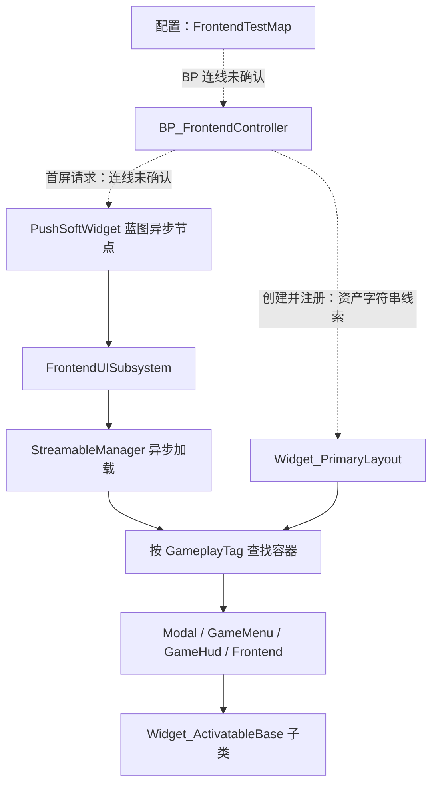

# 菜单启动与 UI 架构

[返回研究报告](README.md)

本文针对 `5b162010276a9e35153fa9f110523e79904f481e` 的项目源码、配置和少量资产可打印字符串做静态研究。未启动编辑器、commandlet，未编译或运行。项目声明 UE 5.5；本机 5.7.3 的兼容性不由本文保证（[工程声明](../FrontendUI.uproject)，第 3 行）。

## 启动链与 C++ 蓝图边界

默认游戏地图、编辑器启动地图都指向 `FrontendTestMap`；视口使用 `CommonGameViewportClient`（[DefaultEngine.ini](../Config/DefaultEngine.ini)，第 4–5、80 行）。C++ 的 `AFrontendPlayerController::OnPossess` 只明确承担两项工作：查找标签为 `Default` 的 CameraActor，找到后选取首个作为视角；CPU 或 GPU 基准结果为 `-1` 时运行并应用硬件基准。它没有创建主布局（[控制器实现](../Source/FrontendUI/Private/Controllers/FrontendPlayerController.cpp)，第 9–27 行）。

布局创建入口主要落在蓝图边界：当前 `Source` 中，`RegisterCreatedPrimaryLayoutWidget` 和 `RegisterWidgetStack` 只有声明、实现，没有调用方；二者暴露给蓝图（[子系统头文件](../Source/FrontendUI/Public/Subsytems/FrontendUISubsystem.h)，第 39–40 行；[布局头文件](../Source/FrontendUI/Public/Widgets/Widget_PrimaryLayout.h)，第 24–25 行）。

二进制资产仅按 ASCII 连续可打印字符提取，得到以下**线索**：

| 资产 | 已见字符串 | 能支持的判断 |
| --- | --- | --- |
| [FrontendTestMap](../Content/Maps/FrontendTestMap.umap) | `DefaultGameMode`、`BP_FrontendGameMode_C` | 地图包含该 GameMode 的引用线索 |
| [BP_FrontendGameMode](../Content/UI/BP_FrontendGameMode.uasset) | `PlayerControllerClass`、`BP_FrontendController_C` | 包含前端控制器类线索 |
| [BP_FrontendController](../Content/UI/BP_FrontendController.uasset) | `ReceiveBeginPlay`、`K2Node_CreateWidget`、`AddToViewport`、`RegisterCreatedPrimaryLayoutWidget`、`PressAnyKeyScreen` | 很可能承担布局组装和首屏请求 |
| [WBP_CUW_PrimaryLayout](../Content/UI/Widgets/WBP_CUW_PrimaryLayout.uasset) | `RegisterWidgetStack`、四个 `WidgetStack_*` 名称 | 四层容器及注册逻辑的资产线索 |

这些字符串不能证明节点是否连接、调用次序、条件分支或最终属性值。因此“地图 → GameMode → 控制器蓝图 → 布局 → 按任意键 → 主菜单”是待蓝图图表／运行确认的启动骨架，不能当作完整执行轨迹。主菜单资产还含 Story、Options、Credit 标签，但不据此认定对应完整业务已实现。

## 类责任与四层容器

`UFrontendUISubsystem` 是 GameInstance 子系统，排除 Dedicated Server；当前类存在已发现的派生类时不创建当前层实例。它保存一个 `CreatedPrimaryLayout`，提供软类加载、入栈和确认弹窗服务，也转发按钮描述事件（[子系统实现](../Source/FrontendUI/Private/Subsytems/FrontendUISubsystem.cpp)，第 15–45 行；[头文件](../Source/FrontendUI/Public/Subsytems/FrontendUISubsystem.h)，第 42–50 行）。布局只负责 `GameplayTag → UCommonActivatableWidgetContainerBase*` 映射；非设计时注册，重复标签不覆盖，查询不到则 `checkf`（[布局实现](../Source/FrontendUI/Private/Widgets/Widget_PrimaryLayout.cpp)，第 8–23 行）。

| 栈标签后缀 | 本项目已确认用途／边界 |
| --- | --- |
| `Modal` | C++ 将确认框、按键重映射屏幕推入此栈 |
| `Frontend` | 控制器、按任意键和主菜单资产含该标签；具体切换连线未确认 |
| `GameMenu` | 已定义标签、布局资产含同名容器；当前 C++ 未见入栈调用 |
| `GameHud` | 已定义标签、布局资产含同名容器；当前 C++ 未见入栈调用 |

四个标签在[FrontendGameplayTags.cpp](../Source/FrontendUI/Private/FrontendGameplayTags.cpp)第 9–12 行定义；Modal 调用见[子系统](../Source/FrontendUI/Private/Subsytems/FrontendUISubsystem.cpp)第 102–110 行和[按键条目](../Source/FrontendUI/Private/Widgets/Options/ListEntries/Widget_ListEntry_KeyRemap.cpp)第 43–57 行。标签本身没有表达 Z-order 或输入优先级，不能仅按名称断言四层实际遮挡顺序。

`UWidget_ActivatableBase` 继承 CommonUI 可激活控件，只增加前端控制器的弱引用缓存；页面导航和默认焦点并未在此统一实现（[基类头文件](../Source/FrontendUI/Public/Widgets/Widget_ActivatableBase.h)，第 13–23 行；[实现](../Source/FrontendUI/Private/Widgets/Widget_ActivatableBase.cpp)，第 7–14 行）。`UFrontendFunctionLibrary` 从配置映射查询页面软类，而非硬编码具体 WBP；七个页面类路径在 [DefaultGame.ini](../Config/DefaultGame.ini)第 8 行配置，缺少标签映射会触发断言（[查询实现](../Source/FrontendUI/Private/FrontendFunctionLibrary.cpp)，第 7–13 行）。

## 软引用显示与确认弹窗

普通蓝图入口 `PushSoftWidget` 缓存世界、控制器、软类和栈标签，并 `RegisterWithGameInstance`。激活后交给子系统 `RequestAsyncLoad`；加载完成检查类与布局，再 `AddWidget`。创建回调阶段先设置 OwningPlayer、广播 `OnWidgetCreatedBeforePush`，让调用方能在入栈前初始化；随后广播 `AfterPush`，按参数对 `GetDesiredFocusTarget()` 设置焦点，最后 `SetReadyToDestroy`（[异步节点](../Source/FrontendUI/Private/AsyncActions/AsyncAction_PushSoftWidget.cpp)，第 8–68 行；[子系统](../Source/FrontendUI/Private/Subsytems/FrontendUISubsystem.cpp)，第 47–73 行）。`AfterPush` 的代码含义是 `AddWidget` 返回后，不是已等待转场动画或首帧显示完成。

确认弹窗复用上述加载路径，固定请求 `ConfirmScreen` 并送入 Modal，在入栈前初始化标题、正文及动态按钮。`Ok` 返回 `Closed`；`YesNo` 返回 `Confirmed/Cancelled`；`OKCancel` 返回 `Confirmed/Cancelled`。按钮复用前会清空旧点击委托，点击时先回调、再 `DeactivateWidget`（[确认屏](../Source/FrontendUI/Private/Widgets/Widget_ConfirmScreen.cpp)，第 10–101 行）。蓝图包装节点的 `OnButtonClicked` 广播后才标记可销毁（[确认异步节点](../Source/FrontendUI/Private/AsyncActions/AsyncAction_PushConfirmScreen.cpp)，第 28–40 行）。

一个不依赖蓝图连线推测的具体调用链是：Options 已绑定 Reset 动作 → `OnResetBoundActionTriggered` 在存在可重置数据时请求 YesNo → 子系统解析确认屏软类并异步入 Modal → `InitConfirmScreen` 创建 Yes/No → Yes 产生 `Confirmed` → Options 遍历 `ResettableDataArray` 调用 `TryResetBackToDefaultValue`；No 提前返回，随后弹窗停用。可追踪入口、条件和结果见[OptionsScreen.cpp](../Source/FrontendUI/Private/Widgets/Options/Widget_OptionsScreen.cpp)第 23–31、103–154 行，以及上面的确认屏回调。

## 输入焦点与组件协作

输入配置采用 EnhancedPlayerInput／EnhancedInputComponent 并启用用户设置；CommonInput 指定默认 InputData，Windows 支持键鼠和手柄、不支持触摸（[DefaultInput.ini](../Config/DefaultInput.ini)，第 79–86 行；[DefaultGame.ini](../Config/DefaultGame.ini)，第 11–22 行）。具体页面的输入模式不能仅由这些全局配置推出；PressAnyKey 资产虽含 `BP_GetDesiredInputConfig`，其返回配置未解析。

Options 通过 CommonUI 注册 Back／Reset，默认焦点返回当前已生成的选中条目；手柄进入条目时，条目请求蓝图提供内部焦点控件（[OptionsScreen](../Source/FrontendUI/Private/Widgets/Options/Widget_OptionsScreen.cpp)，第 19–45、77–87 行；[ListEntry_Base](../Source/FrontendUI/Private/Widgets/Options/ListEntries/Widget_ListEntry_Base.cpp)，第 45–60 行）。按钮组件在 Hover 时广播描述、Unhover 时广播空文本；接收方资产 `WBP_Text_ButtonDescription` 含同名事件，但其绑定时机未确认（[按钮实现](../Source/FrontendUI/Private/Widgets/Components/FrontendCommonButtonBase.cpp)，第 52–66 行；[描述控件资产](../Content/UI/Widgets/WBP_Text_ButtonDescription.uasset)）。TabList 负责生成和命名页签；ListView 按数据类型映射条目，并禁止 Collection 被选择／导航（[TabList](../Source/FrontendUI/Private/Widgets/Components/FrontendTabListWidgetBase.cpp)，第 8–15 行；[ListView](../Source/FrontendUI/Private/Widgets/Components/FrontendCommonListView.cpp)，第 11–32 行）。

## 已证实限制与待运行验证

- **单布局、注册不可替换。** 子系统每个 GameInstance 仅保存一个布局，后注册会替换这个指针；同一布局的同名栈却不覆盖。分屏多玩家或运行时重建局部栈时，不能假设天然按 LocalPlayer 隔离或自动更新。证据：[子系统头文件](../Source/FrontendUI/Public/Subsytems/FrontendUISubsystem.h)第 49–50 行、[注册实现](../Source/FrontendUI/Private/Subsytems/FrontendUISubsystem.cpp)第 40–44 行、[栈注册](../Source/FrontendUI/Private/Widgets/Widget_PrimaryLayout.cpp)第 17–22 行。
- **静态风险：配置／初始化顺序失配。** 提前请求页面、传入未知栈、缺失软类资产或错误确认屏类型时，路径依赖 `check/checkf/CastChecked`，没有失败广播或用户反馈分支。核验条件应包含“注册完成前调用”和“无效映射”；不同构建配置下的表现不能等同为可恢复错误。证据：[加载及确认入口](../Source/FrontendUI/Private/Subsytems/FrontendUISubsystem.cpp)第 49–60、80–110 行。
- **静态风险：跨异步对象存活。** 确认信息通过 `NewObject` 创建后，只见局部原始指针被加载 lambda 捕获；等待加载时若发生 GC，未见 GC 可追踪的持有者。加载 lambda 也捕获子系统 `this`，实现未保存取消句柄；世界／GameInstance 销毁期间回调是否安全需验证。证据：[信息对象创建](../Source/FrontendUI/Private/Widgets/Widget_ConfirmScreen.cpp)第 12、27、47 行；[捕获位置](../Source/FrontendUI/Private/Subsytems/FrontendUISubsystem.cpp)第 51–54、78–110 行。这里是生命周期风险判断，未复现崩溃。
- **静态风险：默认焦点可能被覆盖。** 确认屏的 `NativeGetDesiredFocusTarget` 直接对末尾按钮 `SetFocus()`，却返回 `Super` 的结果。其意图是默认 No／Cancel；当上层继续使用返回值设置焦点时，最终位置待键鼠／手柄实测，不能声称当前一定选中 No。证据：[焦点实现](../Source/FrontendUI/Private/Widgets/Widget_ConfirmScreen.cpp)第 104–115 行、[普通节点焦点逻辑](../Source/FrontendUI/Private/AsyncActions/AsyncAction_PushSoftWidget.cpp)第 53–58 行。
- **静态风险：非按钮关闭没有完成路径。** 若确认框被外部停用、清栈或切图，确认异步节点只有按钮回调中的 `SetReadyToDestroy`；当前实现未提供取消完成事件。是否发生滞留、调用方是否一直等待，需实际生命周期验证（[确认异步节点](../Source/FrontendUI/Private/AsyncActions/AsyncAction_PushConfirmScreen.cpp)，第 19、28–40 行）。

上述验证均为后续候选，不表示本次执行过。当前结论止于源码控制流、配置值与有限资产字符串；布局视觉层级、蓝图节点顺序、焦点恢复及 UE 5.7.3 运行表现仍未知。
