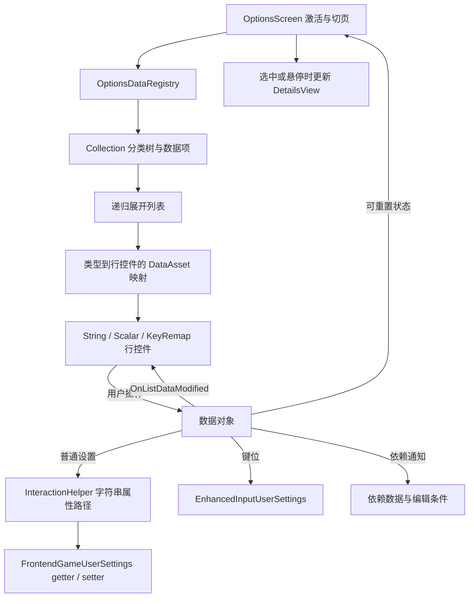

# Options 设置系统研究

[返回研究报告](README.md)

本文基于提交 `5b162010276a9e35153fa9f110523e79904f481e` 的项目 C++ 静态阅读，面向 UE 5.5。未启动编辑器、commandlet、编译或运行游戏；引擎基类内部实现、蓝图事件图和重启后的持久化结果不在已验证范围内。源码链接相对本文件目录，`#L` 为当前提交行号。

## 数据视图与设置存储的分工

`UWidget_OptionsScreen` 第一次激活时懒创建 `UOptionsDataRegistry`，注册 Gameplay、Audio、Video、Control 四个页签；切页时把该页集合递归展开为列表项，包括分类标题。`Collection::AddChildListData` 会立即初始化子对象，再设置父对象和加入数组，因此 getter、候选值、默认值必须先配好。Registry、集合和页面通过 `UPROPERTY(Transient)` 引用维持数据对象生命周期。[OptionsScreen::GetOrCreateDataRegistry，90 行](../Source/FrontendUI/Private/Widgets/Options/Widget_OptionsScreen.cpp#L90)、[Registry，25、33 行](../Source/FrontendUI/Private/Widgets/Options/OptionsDataRegistry.cpp#L25)、[Collection，6 行](../Source/FrontendUI/Private/Widgets/Options/DataObjects/ListDataObject_Collection.cpp#L6)。

数据层的职责是分开的：`Base` 保存 ID、标题、说明、图片、通知与编辑条件；`Collection` 保存子项；`Value` 增加动态 getter/setter 和可选默认字符串；`String` 管理选项及显示文本，派生出 Bool、Enum、Integer、Resolution；`Scalar` 负责滑条显示区间与真实输出区间映射；`KeyRemap` 直接操作 Enhanced Input，不经过 `Value`。[Base.h，23 行](../Source/FrontendUI/Public/Widgets/Options/DataObjects/ListDataObject_Base.h#L23)、[Value.h，19 行](../Source/FrontendUI/Public/Widgets/Options/DataObjects/ListDataObject_Value.h#L19)。

列表根据数据对象类型查询 `DataAsset_DataListEntryMapping`，从当前类向父类查找映射，所以 String 的派生类型可复用同一行控件；未匹配则回退到 ListView 的默认行。分类集合不允许选择/导航。行控件把鼠标按钮、手柄 Rotator、Slider 操作转给数据对象，再订阅数据通知刷新显示。具体蓝图行类、布局、高亮与手柄焦点由资产实现，C++ 只给出映射机制和事件契约。[映射查找，7 行](../Source/FrontendUI/Private/Widgets/Options/DataAsset_DataListEntryMapping.cpp#L7)、[ListView，11、30 行](../Source/FrontendUI/Private/Widgets/Components/FrontendCommonListView.cpp#L11)、[行控件蓝图契约，22 行](../Source/FrontendUI/Public/Widgets/Options/ListEntries/Widget_ListEntry_Base.h#L22)。

## 反射桥接与修改通知和依赖

Registry 的 `MAKE_OPTIONS_DATA_CONTROL` 用 `GET_FUNCTION_NAME_STRING_CHECKED` 获取函数名；`FOptionsDataInteractionHelper` 缓存 `FCachedPropertyPath` 与设置对象弱引用，通过 `PropertyPathHelpers::GetPropertyValueAsString/SetPropertyValueFromString` 读写。这里传入的是 getter/setter 函数路径，而非裸成员地址；自定义设置函数因此标为 `UFUNCTION()`。字符串把普通字符串、布尔值、枚举名、整数、浮点数以及分辨率 `(X=1920,Y=1080)` 统一到同一接口。[Registry 宏，20 行](../Source/FrontendUI/Private/Widgets/Options/OptionsDataRegistry.cpp#L20)、[Helper，7 行](../Source/FrontendUI/Private/Widgets/Options/OptionsDataInteractionHelper.cpp#L7)、[Settings.h，23 行](../Source/FrontendUI/Public/FontendSettings/FrontendGameUserSettings.h#L23)。

String 初始化依次采用“首个候选值 → 注册默认值 → 非空 getter 结果”，只改变显示缓存，不因此把默认值写回设置。候选中找不到值时通常显示 `Invalid Option`；Integer 显示 `Custom`；Resolution 可显示设置中实际的尺寸。[String，9、245 行](../Source/FrontendUI/Private/Widgets/Options/DataObjects/ListDataObject_String.cpp#L9)、[Resolution，34 行](../Source/FrontendUI/Private/Widgets/Options/DataObjects/ListDataObject_StringResolution.cpp#L34)。

用户修改先调用 setter，再 `NotifyListDataModified`：先广播 `OnListDataModified`，随后按 `bShouldApplyChangeImmediatly` 决定是否 `ApplySettings(true)`。原因枚举区分直接修改、恢复默认、依赖修改，但不是提交事务。[Base，68 行](../Source/FrontendUI/Private/Widgets/Options/DataObjects/ListDataObject_Base.cpp#L68)。

`AddEditCondition` 存判断函数、禁用说明及可选强制值；`AddEditDependencyData(B)` 则让当前对象订阅 B 的修改。只有写条件不会自动订阅。`IsDataCurrentlyEditable()` 也不是纯查询：条件失败时可能调用 setter 强制改值并广播。行控件在绑定数据或接到依赖通知时查询它，DetailsView 在展示说明时也查询它。总体画质与八项整数画质互相订阅，Integer 先比较 getter 新旧值，相同便返回以阻止无效循环；3D Resolution 只订阅总体画质。[Base，12–61 行](../Source/FrontendUI/Private/Widgets/Options/DataObjects/ListDataObject_Base.cpp#L12)、[StringInteger，255 行](../Source/FrontendUI/Private/Widgets/Options/DataObjects/ListDataObject_String.cpp#L255)、[DetailsView，10 行](../Source/FrontendUI/Private/Widgets/Options/Widget_OptionsDetailsView.cpp#L10)。

## 实际注册的选项及默认值

下表列的是 Registry 的代码注册内容；Control 的具体动作与按键须由运行时保存的 profile 和输入资产确定。

| 页签 / 分类 | 实际数据项与取值 | 本 UI 注册的恢复默认值 |
| --- | --- | --- |
| Gameplay | Difficulty：Easy / Normal / Hard / Very Hard；Test Image Item：仅演示说明图，无候选值和 getter/setter | Difficulty 为 Normal；图片项不可重置 |
| Audio / Volume | Overall、Music、Sound Effects Volume；显示 0–100%，输出 0–2，步长 0.01 | 输出 1，即显示 50% |
| Audio / Sound | Allow Background Audio、Use HDR Audio Mode | 均 false |
| Video / Display | Window Mode：Fullscreen / Borderless Window / Windowed；Screen Resolution：平台枚举所得尺寸 | Borderless；按 `SizeSquared()` 排序后的最后一个尺寸 |
| Video / Graphics | Brightness：显示 0–100%，输出 gamma 1.7–2.7；Overall Quality：0–4；3D Resolution：标准化 0–1 | Brightness 输出 2.2；总体画质与 3D Resolution 未注册默认值 |
| Video / Graphics | Global Illumination、Shadow、AntiAliasing、View Distance、Texture、Visual Effect、Reflection、Post Processing：均 0–4；视距文案是 Near 至 Cinematic，其余主要为 Low 至 Cinematic | 八项均未注册默认值 |
| Video / Advanced Graphics | V-Sync；Frame Rate Limit：30 / 60 / 90 / 120 / 0（No Limit） | false；0 |
| Control | Keyboard & Mouse、Gamepad 两组，从全部保存的 key profiles、rows、slots 动态生成 | 各映射自带 DefaultKey |

注册依据：[Gameplay，89 行](../Source/FrontendUI/Private/Widgets/Options/OptionsDataRegistry.cpp#L89)、[Audio，133 行](../Source/FrontendUI/Private/Widgets/Options/OptionsDataRegistry.cpp#L133)、[Video，247 行](../Source/FrontendUI/Private/Widgets/Options/OptionsDataRegistry.cpp#L247)、[Control，632 行](../Source/FrontendUI/Private/Widgets/Options/OptionsDataRegistry.cpp#L632)。视频描述使用 `ST_OptionsScreenDescription` 字符串表；没有实际解码表内文本。

保存与恢复有三条边界：

1. 除 Brightness 和演示图片项外，已注册的普通值项都启用立即 Apply；退出 Options 又调用一次 `ApplySettings(true)`，Back 没有撤销快照或丢弃修改流程。难度与音频字段标为 `UPROPERTY(Config)`，持久化委托给 `UGameUserSettings` 基类；本次只确认调用路径，未验证实际落盘或重启读取。[页面退出，70 行](../Source/FrontendUI/Private/Widgets/Options/Widget_OptionsScreen.cpp#L70)、[Config 字段，71 行](../Source/FrontendUI/Public/FontendSettings/FrontendGameUserSettings.h#L71)。
2. Brightness 的 setter 直接写 `GEngine->DisplayGamma`，自身没有 Config 存储字段，也没有注册立即 Apply；因此可以确认内存写入，不能据此宣称跨启动保存。音频 setter 只赋字段，总体音量处还保留实际音量控制逻辑的注释占位；项目 C++ 未见相应音频或难度业务消费，不能将滑条变化等同于听觉/难度效果，蓝图消费也未验证。[Settings.cpp，25–68 行](../Source/FrontendUI/Private/FontendSettings/FrontendGameUserSettings.cpp#L25)。
3. 页签 Reset 只处理当前 `ResettableDataArray` 中“有默认值且与当前不同”的项，经确认后逐项 reset；不是重置整个 `UGameUserSettings`。String 精确比较，Scalar 用输出值与 0.01 容差比较；无默认值的画质项不参与。恢复时仍会通知及应用，`bIsResettingData` 只抑制页面重建重置集合。[Reset，103 行](../Source/FrontendUI/Private/Widgets/Options/Widget_OptionsScreen.cpp#L103)、[Scalar，53 行](../Source/FrontendUI/Private/Widgets/Options/DataObjects/ListDataObject_Scalar.cpp#L53)。

## WindowMode 对 Resolution 的限制过程

假设在非编辑器环境，Resolution 行已生成且订阅了依赖通知：点击 Window Mode 下一项 → String 改缓存并通过 `SetFullscreenMode` 写设置 → 广播 WindowMode 修改 → Resolution 收到依赖通知 → 行重新执行 `IsDataCurrentlyEditable()`。当模式为 Borderless 时，条件失败，Resolution 被设为枚举尺寸中的最大值，并广播 `DependencyModified`、应用设置，随后行控件禁用。WindowMode 自身广播结束后也会 Apply。切回可编辑模式只解除禁用，不恢复先前分辨率。[条件与订阅，299–326 行](../Source/FrontendUI/Private/Widgets/Options/OptionsDataRegistry.cpp#L299)、[行依赖刷新，89 行](../Source/FrontendUI/Private/Widgets/Options/ListEntries/Widget_ListEntry_Base.cpp#L89)。

如果行尚未生成，基础依赖回调只广播，不自行求条件；后续创建行或展示 DetailsView 时才会再次求值。因此不能把这套 UI 条件当成独立于界面的底层设置约束。Window Mode 与 Resolution 另有 `GIsEditor || GIsPlayInEditorWorld` 禁用条件，这就是代码中“仅打包版本可修改”提示的实际判断。

## 键位重映射与输入捕获生命周期

Registry 分别用键鼠/手柄查询条件过滤全部已保存 profiles 的 mappings，为每条缓存 profile、MappingName、Slot 和目标输入类型。图标从 `UCommonInputPlatformSettings::TryGetInputBrush` 获取，并使用当前手柄名；找不到时返回空 Brush。[KeyRemap 数据，10、19 行](../Source/FrontendUI/Private/Widgets/Options/DataObjects/ListDataObject_KeyRemap.cpp#L10)。

点击重映射按钮后，行控件异步推入 Modal 层；在 `OnCreatedBeforePush` 阶段绑定完成/取消回调并设置目标输入类型。弹窗激活创建 `FKeyRemapScreenInputPreprocessor` 并注册到 Slate；它消费按键按下和鼠标按钮按下事件，Escape 取消，设备不匹配取消，手柄模式下把模拟左键点击转换为 CommonUI 的默认手柄点击键。这里未实现滚轮或模拟轴捕获。[行控件，39 行](../Source/FrontendUI/Private/Widgets/Options/ListEntries/Widget_ListEntry_KeyRemap.cpp#L39)、[输入预处理器，33–101 行](../Source/FrontendUI/Private/Widgets/Options/Widget_KeyRemapScreen.cpp#L33)。

成功或取消都通过 CoreTicker 延迟一 tick，先执行回调再 Deactivate；停用时注销预处理器并释放 shared pointer。成功回调执行 `MapPlayerKey`，紧接 `SaveSettings()` 和数据通知；单项/页签恢复则对映射 `ResetToDefault()` 后保存。故键位没有等待退出 Options 才保存的步骤；是否及时重建实际游戏输入映射需要运行时验证。[捕获生命周期，113–192 行](../Source/FrontendUI/Private/Widgets/Options/Widget_KeyRemapScreen.cpp#L113)、[重映射与恢复，48–100 行](../Source/FrontendUI/Private/Widgets/Options/DataObjects/ListDataObject_KeyRemap.cpp#L48)。

## 静态风险与验证边界

以下是源码可见条件，不是已经复现的运行时故障：

| 触发条件 | 静态证据与可能影响 | 后续最小验证 |
| --- | --- | --- |
| V-Sync 行存在时切换 Window Mode | V-Sync 添加 Fullscreen 条件及强制 false，却没有像 Resolution 一样添加 WindowMode 依赖；启用状态可能保留到下一次行绑定。详情查询能强制值，却不会同步调用该行的启用状态切换。[Registry，585–606 行](../Source/FrontendUI/Private/Widgets/Options/OptionsDataRegistry.cpp#L585) | 在打包版观察模式切换后的控件启用与实际 V-Sync 值 |
| 平台未返回任何全屏分辨率 | 未检查枚举结果便调用数组 `Last()`，存在空数组访问路径。[Resolution，15–29 行](../Source/FrontendUI/Private/Widgets/Options/DataObjects/ListDataObject_StringResolution.cpp#L15) | 无有效显示模式环境下验证枚举结果与失败处理 |
| ListView 回收行并绑定另一数据对象，旧数据随后变化 | `OnOwningListDataObjectSet` 向数据订阅；`NativeOnEntryReleased` 只清理高亮，未解绑旧订阅。旧对象可触发当前行的额外刷新；影响程度取决于复用和依赖通知时序。[Base 行，38、63 行](../Source/FrontendUI/Private/Widgets/Options/ListEntries/Widget_ListEntry_Base.cpp#L38) | 滚动复用后修改总体画质，检查回调来源与次数 |
| MapPlayerKey 拒绝映射，或存在多个 profiles | 失败标签 `Container` 未检查仍保存并通知；读取用缓存 profile，写入参数只填写名称、slot、新键，未显式携带该 profile 身份。失败提示及多 profile 一致性需核对引擎行为。[KeyRemap，48、92 行](../Source/FrontendUI/Private/Widgets/Options/DataObjects/ListDataObject_KeyRemap.cpp#L48) | 构造失败与多 profile 场景，核对真实读写目标；不预设引擎默认选哪一个 |

此外，Helper 未检查属性路径操作结果；扩展时若反射路径或字符串类型不匹配，UI 通知不能作为写入成功证明。捕获弹窗的 ticker lambda 捕获裸 `this`，且没有保存 ticker handle 或“已请求关闭”状态；同 tick 多次按下、外部提前关闭是值得检查的生命周期场景，未据此认定必然崩溃。[Helper，13 行](../Source/FrontendUI/Private/Widgets/Options/OptionsDataInteractionHelper.cpp#L13)、[RequestDeactivateWidget，178 行](../Source/FrontendUI/Private/Widgets/Options/Widget_KeyRemapScreen.cpp#L178)。

## 新增设置项的实施位置

以新增一个普通布尔业务设置为例，以下是后续实施步骤，本次未修改实现：

1. 在 `FrontendGameUserSettings` 增加需要持久化的 `UPROPERTY(Config)` 字段及明确初始值，提供 `UFUNCTION()` getter/setter；明确业务实际如何消费该值，单纯赋值不代表功能生效。
2. 在目标 `Init*CollectionTab` 创建 `UListDataObject_StringBool`，设置唯一 DataID、标题/描述、默认值、getter/setter helper，以及是否立即 Apply。UI 默认值与存储初始值应一致；最后才 `AddChildListData`。
3. 有编辑限制时，添加条件、禁用文案和必要的强制值；依赖其他选项时另加 `AddEditDependencyData`。确定强制赋值是否允许丢弃先前值。
4. 检查映射 DataAsset 是否已配置 String 行；Bool 可通过父类查找复用该映射。若引入全新数据/控件类型，再配置新映射、行蓝图的 BindWidget 与手柄焦点事件。检查描述字符串表或图片 tag 是否配置。
5. 后续获准运行时，验证首次加载、鼠标/手柄修改、getter 回读、依赖切换、Reset、退出重进及重启；涉及业务效果还须单独验证实际消费者。

学习阅读顺序：先看 [OptionsDataRegistry.cpp](../Source/FrontendUI/Private/Widgets/Options/OptionsDataRegistry.cpp) 中一个 Audio 条目，接着读 [Scalar.cpp](../Source/FrontendUI/Private/Widgets/Options/DataObjects/ListDataObject_Scalar.cpp) → [InteractionHelper.cpp](../Source/FrontendUI/Private/Widgets/Options/OptionsDataInteractionHelper.cpp) → [GameUserSettings.cpp](../Source/FrontendUI/Private/FontendSettings/FrontendGameUserSettings.cpp)；然后读 Base 的通知/条件、OptionsScreen 的切页/Reset 与对应行控件；最后沿 WindowMode→Resolution 和 KeyRemap 的完整链阅读，避免一开始就陷入所有画质条目的重复注册代码。
