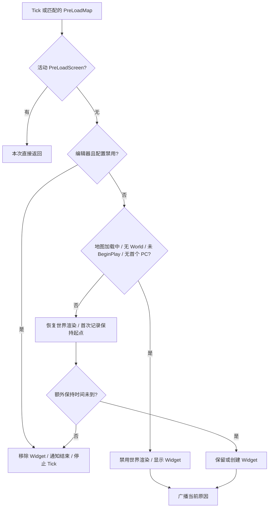

# 加载画面与生命周期

[返回研究报告](README.md)

本文基于 commit `5b162010276a9e35153fa9f110523e79904f481e` 静态阅读。项目目标为 UE 5.5；本机 UE 5.7.3 仅辅助核实 Slate/GC 机制，不代表已验证版本兼容。未启动编辑器、编译、运行或解析蓝图图表。

## 两条加载画面路径

| 路径 | 已确认配置与边界 |
| --- | --- |
| 启动视频 | [DefaultGame.ini:125](../Config/DefaultGame.ini#L125) 的 MoviePlayer 设置启用等待播放完成、禁止跳过，启动列表仅有 `LoadingScreenSequence5s`。目录实际存在 [5s](../Content/Movies/LoadingScreenSequence5s.mp4)、[10s](../Content/Movies/LoadingScreenSequence10s.mp4) 两个文件；10s 未列入该启动列表。 |
| 运行时 Widget | [DefaultGame.ini:130](../Config/DefaultGame.ini#L130) 指向实际存在的 [WBP_LoadingScreen](../Content/UI/Widgets/WBP_LoadingScreen.uasset)，设置额外保持 3 秒、编辑器不显示。地图目录存在 [FrontendTestMap](../Content/Maps/FrontendTestMap.umap)，文件存在不证明地图或蓝图内部连线。 |

`TryUpdateLoadingScreen` 首先查询 `FPreLoadScreenManager::HasValidActivePreLoadScreen()`，为真便整次返回；未直接查询 MoviePlayer 播放状态。因而只能确认它避让活动的 PreLoadScreen，不能把这项检查写成“已保证与启动视频无缝衔接”。见[子系统:94、125](../Source/FrontendUI/Private/Subsytems/FrontendLoadingScreenSubsystem.cpp#L94)。MoviePlayer 字段语义也与本机 [MoviePlayerSettings.h:26](E:/Epic/UE_5.7/Engine/Source/Runtime/MoviePlayer/Public/MoviePlayerSettings.h#L26) 注释一致。

## GameInstance 与地图事件的更新顺序

类同时继承 `UGameInstanceSubsystem`、`FTickableGameObject`，不是随单个 Actor 存亡。[声明:13](../Source/FrontendUI/Public/Subsytems/FrontendLoadingScreenSubsystem.h#L13)。`ShouldCreateSubsystem` 排除 Dedicated Server；发现派生类时当前类返回 false。`Initialize` 绑定 Pre/PostLoadMap，`Deinitialize` 仅移除这两项绑定。[实现:12–35](../Source/FrontendUI/Private/Subsytems/FrontendLoadingScreenSubsystem.cpp#L12)

模板对象不 Tick，其余初始为 Conditional；`IsTickable` 要求 GameInstance 和 Viewport 有效，Tick 所属 World 来自 GameInstance，每次调用 `TryUpdateLoadingScreen`。[实现:37–64](../Source/FrontendUI/Private/Subsytems/FrontendLoadingScreenSubsystem.cpp#L37)。PreLoadMap 先核对所属 GameInstance，再启用 Tick、设置加载标记并立即更新；PostLoadMap 只对匹配且非空的 World 清除标记，退出画面仍等后续 Tick。[地图回调:72–91](../Source/FrontendUI/Private/Subsytems/FrontendLoadingScreenSubsystem.cpp#L72)

`ShouldShowLoadingScreen` 的优先级如下，前项命中即返回：[实现:135–208](../Source/FrontendUI/Private/Subsytems/FrontendLoadingScreenSubsystem.cpp#L135)。

1. `GIsEditor && !bShouldShowLoadingScreenInEditor`：直接不显示；判断不限于某一种 PIE 窗口形式。
2. 正在地图加载、World 不存在、World 尚未 BeginPlay、首个 PlayerController 不存在：按此顺序检查并设置原因，禁用世界渲染。
3. 均满足后恢复世界渲染，将原因写为 `Waiting for Texture Streaming`，按平台时间等待额外秒数。这里只是定时保持，没有查询纹理流送完成状态。

保持到期后移除 Widget、把计时起点重置为 `-1`、通知结束并把 Tick 设为 Never；下一次匹配的 PreLoadMap 才重新启用。[更新函数:110–121](../Source/FrontendUI/Private/Subsytems/FrontendLoadingScreenSubsystem.cpp#L110)

## 显示接口与资源管理

首次显示从软类引用同步加载 Widget 类，以 GameInstance 创建 `UUserWidget`；`TakeWidget()` 得到的 Slate 控件缓存为 `TSharedPtr<SWidget>`，通过 `AddViewportWidgetContent(..., 1000)` 加入视口 Overlay。缓存有效时跳过重复创建。移除使用相同 Slate 引用，再 `Reset()` 缓存。[显示/移除:211–246](../Source/FrontendUI/Private/Subsytems/FrontendLoadingScreenSubsystem.cpp#L211)；[类加载:7–13](../Source/FrontendUI/Private/FontendSettings/FrontendLoadingScreenSettings.cpp#L7)。

接口只有 `OnLoadingScreenActivated/Deactivated` 两个 `BlueprintNativeEvent`，不存在“是否就绪”的接口轮询。[接口:25–30](../Source/FrontendUI/Public/Interfaces/FrontendLoadingScreenInterface.h#L25)。显示与结束时遍历 LocalPlayers，对当时存在且实现接口的 PlayerController、Pawn 发通知；没有遍历 GameState、PlayerState 或组件。显示期间每次更新还广播原因，而非仅在原因变化时广播。[通知:249–291](../Source/FrontendUI/Private/Subsytems/FrontendLoadingScreenSubsystem.cpp#L249)；[原因广播:108](../Source/FrontendUI/Private/Subsytems/FrontendLoadingScreenSubsystem.cpp#L108)。

这段 C++ 没有切换 InputMode、禁用输入或安装输入拦截器；`bDisableWorldRendering` 只表达渲染开关。输入屏蔽及恢复是否由蓝图回调实现，本次无法确认；不能仅凭 Overlay 层级推断全部输入被阻挡。

缓存不是 `UPROPERTY` 并不自动构成 GC 缺陷：本机引擎 [Widget.cpp:1022](E:/Epic/UE_5.7/Engine/Source/Runtime/UMG/Private/Components/Widget.cpp#L1022) 将 UserWidget 包进 `SObjectWidget`，后者通过 [AddReferencedObjects:104](E:/Epic/UE_5.7/Engine/Source/Runtime/UMG/Private/Slate/SObjectWidget.cpp#L104) 保持 UObject 引用。移出视口并释放共享引用后，符合条件才可被 GC；并非 `Reset()` 当场销毁 UObject。

## 可由源码确认的限制

| 条件 | 影响与依据 |
| --- | --- |
| 延时阶段再次发生地图加载 | PreLoadMap 和“仍需加载”分支不重置保持起点；下一地图准备好后可能少于完整 3 秒。见上文地图回调、`ShouldShowLoadingScreen:145–166`。 |
| Widget 创建时 PC/Pawn 尚不存在，随后才生成 | 缓存使显示函数提前返回，不补发 Activated；结束通知却面向当时的对象，不能依赖成对回调。见 `TryDisplayLoadingScreenIfNone:214`、通知函数。 |
| 加载未完成即反初始化 | `Deinitialize:31` 没有显式移除 Overlay、恢复世界渲染或通知结束；清理由外部生命周期承担，实际残留需运行验证，不能据此断言泄漏。 |
| 资产引用缺失或加载失败 | 类加载仅检查软引用非空，随后同步加载；创建结果使用 `check`，无备用画面。不同构建的失败表现尚未验证。见类加载函数及显示函数。 |

另外，就绪条件只到“首个 PC 存在”；GameState、PlayerState、Pawn、组件等检查在第 206 行仍是注释。结束后停止 Tick，也不会自行监测后续异步准备状态。

## 后续运行验证清单

以下检查本次未执行。

- 分别验证默认 PIE、开启编辑器显示、独立运行的入口差异及启动视频到 Widget 的衔接。
- 观察地图加载、BeginPlay、PC 创建、额外 3 秒的先后顺序，以及延时内连续切图。
- 检查键鼠/手柄输入、焦点与通知配对，特别是晚生成或被替换的 PC/Pawn。
- 在画面显示时结束会话，检查 Overlay、世界渲染状态和 GC；另验证缺失 Widget 类的实际失败表现。
