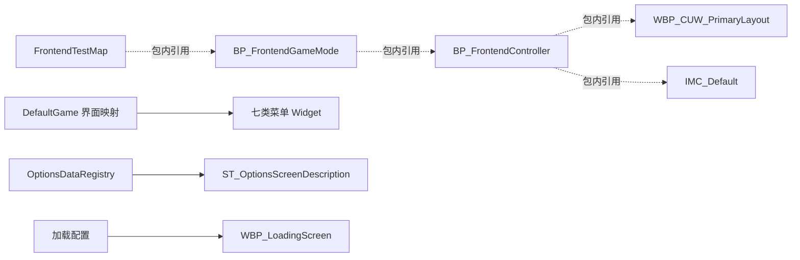

# 资源组织与验证记录

[返回研究报告](README.md)

本工程的源文件和 LFS 资源已完整下载。需要继续验证的是引擎加载、蓝图行为和版本兼容性，不能把这些问题与下载缺失混为一谈。记录基于 2026-10-13 的本地静态检查，工程提交为 `5b162010276a9e35153fa9f110523e79904f481e`。

## 资源分布

| 内容目录 | 文件数 | 内容与用途 |
| --- | ---: | --- |
| [Assets/Audio](../Content/Assets/Audio) | 8 | 音乐、爆炸音效、SoundCue、SoundClass 与 SoundMix |
| [Assets/ControllerIcons](../Content/Assets/ControllerIcons) | 117 | 键鼠及 PS4 输入图标 |
| [Assets/Fonts](../Content/Assets/Fonts) | 9 | DIN 与 Cinzel 字体资源 |
| [Assets/LevelVisuals](../Content/Assets/LevelVisuals) | 155 | 场景演示蓝图、Manny/Quinn、骨骼、动画、材质及贴图 |
| [Assets/Materials](../Content/Assets/Materials) | 4 | 圆形进度与加载动画材质 |
| [Assets/Textures](../Content/Assets/Textures) | 10 | 箭头、分隔线、滑条、按键重映射背景等 UI 纹理 |
| [UI](../Content/UI) | 53 | 菜单、设置项、样式、输入动作、映射及字符串表 |
| [Maps](../Content/Maps) | 1 | `FrontendTestMap.umap` |
| [Movies](../Content/Movies) | 2 | `LoadingScreenSequence5s.mp4` 和 `LoadingScreenSequence10s.mp4` |

`Assets` 合计 303 个资源，`UI` 合计 53 个资源，再加一个地图和两个视频，总计 359 个内容文件。53 个 UI 资源中包含 4 个 CommonInputData、6 个输入资产、1 个字符串表、4 个按钮样式、11 个文字样式，以及界面和数据映射资产；6 个输入资产由 5 个 InputAction 与一个 `IMC_Default` 组成。

入口地图由 [DefaultEngine.ini](../Config/DefaultEngine.ini)第 4–5 行指定，打包地图由 [DefaultGame.ini](../Config/DefaultGame.ini)第 120 行指定。启动视频配置选择的是 5 秒版本，第 128 行；文件名中的时长标签没有在本次检查中通过媒体解码测量。

## 内容引用关系

虚线只表示二进制包里可提取到相应引用，不表示已还原蓝图执行顺序。特别是游戏开始后输入上下文何时注册、菜单按钮如何跳转、加载通知如何影响角色与输入，都需要阅读真实蓝图图表或运行检查。

`DefaultGame.ini` 第 9 行的演示图片引用 `/Fab/Placeholders/FabLogo.FabLogo`，第 121 行的额外打包目录引用 `/NNEDenoiser`。二者属于引擎插件内容，不位于项目 `Content` 中。本机 UE 5.7 安装目录中存在 `FabLogo.uasset`、Fab 和 NNEDenoiser 插件描述文件；是否在目标构建中加载、引用和打包仍属于后续验证范围。

## 下载完整性证据

| 检查 | 实际结果 | 结论范围 |
| --- | --- | --- |
| `git ls-remote origin refs/heads/main` 与本地 HEAD | 均为 `5b162010276a9e35153fa9f110523e79904f481e` | 检查时与远端主分支提交一致 |
| `git fsck --full` | 退出码 0 | 已下载 Git 对象结构通过校验 |
| Git 跟踪文件存在性 | 448 个全部存在 | 没有跟踪文件漏下载 |
| 普通文件 Git blob 哈希 | 89 个全部匹配 | 源码和配置等文件与基线一致 |
| `git lfs fsck` | `Git LFS fsck OK` | 本地 LFS 对象通过校验 |
| LFS 工作文件大小与 SHA-256 | 359 个全部匹配，总计 484824627 字节，约 462.36 MiB | 下载后的实际资源完整，不是仅下载了指针 |
| LFS 指针残留 | 0 | `Content` 没有未展开的 LFS 占位文件 |
| `.uasset` 与 `.umap` 包头 | 357 个均匹配 UE 包签名 | 文件格式头正确，不等于 UE 能成功加载所有内容 |
| Git 子模块 | 当前树中没有 `160000` 子模块条目 | 没有额外子模块下载步骤 |

`Config/DefaultEditor.ini` 是唯一的零字节跟踪文件，Git 中的原始 blob 本身也是零字节，因此不是损坏。下载使用浅克隆，只有当前快照所需历史；课程各阶段的完整提交历史不在本地，但这不影响当前版本文件完整性。

上述哈希与远端核对在本次研究前的同一会话中实际执行；新增 `Documentation` 后，仅文档应出现在工作区变化中，不应再将整个工作区描述为“完全无变化”。

## 与最初配套素材的差异

最初的 `1 - Introduction/Assets` 有 317 个 `.uasset`。其中 22 个 `ControllerIcons/XBox/XboxSeriesX_*.uasset` 没有出现在下载提交的 Git 树中；这些文件仍保留在原配套目录，未自动复制进新工程。GitHub 工程现有 `ControllerData_Gamepad` 的可提取引用指向已有 PS4 图标，未发现对这 22 个 Xbox 图标的路径引用。

整个 `Content` 比最初素材新增了 62 个资产或地图，同时少了上述 22 个图标，得到 357 个 UE 包文件。新增内容包括音频、UI、输入配置与演示地图。对比说明的是两个资料集合的差异，不能把原配套里有而 Git 树中没有的文件归类为下载失败。

包内 `/Game` 字符串扫描还发现几类旧路径：两个导入目录记录、Manny/Quinn 的旧预览或重定向源网格路径、三个 Jeremie 开发目录下的 ControlRig 函数来源路径。前两条导入目录位于 Interchange 元数据；其余引用是否影响预览或编辑，需要 UE 验证。字符串存在本身不足以判定为运行时硬依赖缺失。当前课程 UI 和地图的扫描没有发现新的未匹配 `/Game` 包路径。

## UE 5.7 适配前的状态

| 项目 | 现状与含义 |
| --- | --- |
| 工程关联版本 | [FrontendUI.uproject](../FrontendUI.uproject)仍是 `5.5`，未修改 |
| 构建规则 | [Game Target](../Source/FrontendUI.Target.cs)与[Editor Target](../Source/FrontendUIEditor.Target.cs)使用 `BuildSettingsVersion.V5` 和 `EngineIncludeOrderVersion.Unreal5_5` |
| 本机引擎 | `E:/Epic/UE_5.7/Engine/Build/Build.version` 确认为 5.7.3；它不能代表本工程已经兼容 |
| 直接启用插件 | ModelingToolsEditorMode、CommonUI、MediaMovieStreamer；本机 5.7 安装中均有描述文件 |
| 核心模块依赖 | [FrontendUI.Build.cs](../Source/FrontendUI/FrontendUI.Build.cs)使用 EnhancedInput、GameplayTags、UMG、CommonInput、PropertyPath、PreLoadScreen、Slate 等；`.uproject` 另列 CommonUI、DeveloperSettings 等 AdditionalDependencies |
| 工具链声明 | [.vsconfig](../.vsconfig)列出 VS C++ 工具、游戏开发工作负载和 Windows SDK；文件存在不等于每个组件已安装 |
| 编译生成内容 | `Binaries`、`Intermediate` 未随仓库提供；[.gitignore](../.gitignore)排除了这些目录，首次构建需要生成 |
| 渲染设置 | 默认 DX12，配置启用距离场、光线追踪及虚拟阴影相关项；首次打开的着色器准备时间未测量 |

不要仅因为 `.Build.cs` 没有重复列出某个 `.uproject` 的依赖，就下结论说必然无法编译。本机 UE 5.7 的 UnrealBuildTool `UEBuildTarget.cs` 第 6259–6261 行会将当前模块的 `AdditionalDependencies` 加入构建规则；具体在目标环境中的兼容性仍应由真实构建判定。

## 后续验证顺序

以下是后续执行建议，本次没有执行。应先决定继续使用 5.5，还是在独立副本中迁移到 5.7，再展开运行验证。

| 顺序 | 验证内容 | 判定标准 |
| --- | --- | --- |
| 1 | 目标引擎下生成工程并编译 Editor Target | 编译与链接成功，日志没有缺模块或版本 API 错误 |
| 2 | 打开 `FrontendTestMap`，检查 GameMode、Controller、布局注册 | 地图加载成功，四类栈已注册，首个菜单能显示 |
| 3 | 依次进入菜单、确认框和返回操作 | 无空引用或异步加载错误，键鼠和手柄焦点合理 |
| 4 | 验证设置修改、依赖刷新、默认值与重启恢复 | 数据和显示一致；声音效果、亮度持久化分别实测 |
| 5 | 验证键位重映射、取消、设备类型切换与重启 | 绑定保存正确，没有残留输入预处理器 |
| 6 | 在满足项目编辑条件的环境中验证窗口模式、分辨率与 VSync | 禁用说明、强制值和依赖状态同步更新 |
| 7 | 验证地图加载、启动视频、额外保持时间及中途退出 | 遮罩显示和清理正确，世界渲染恢复，通知接收符合预期 |
| 8 | 在开发打包版本验证软引用、插件内容和视频 | 相关资源被包含，功能不依赖编辑器中恰好已加载的资产 |

加载界面默认 `bShouldShowLoadingScreenInEditor=False`，窗口模式和分辨率也有编辑器禁用条件；仅观察 PIE 界面不能覆盖这些功能。验证时应先理解项目自己的条件，再判断是否为兼容问题或缺失资源。
