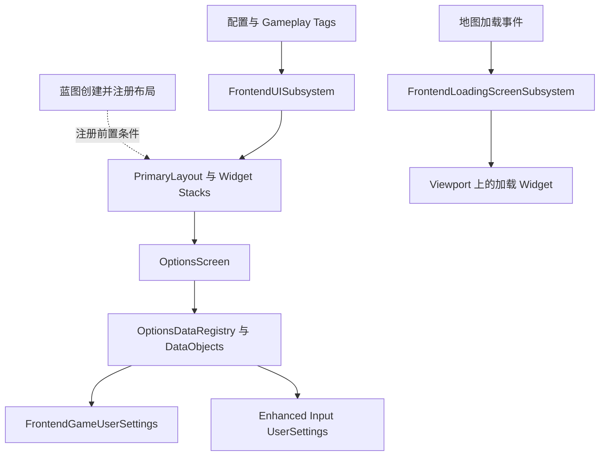

# FrontendUI 项目研究报告

FrontendUI 是一个以 Common UI 为基础的游戏前端菜单课程工程。它把界面栈与异步打开、数据驱动的设置列表、键位重映射、地图加载遮罩组合在一个 `FrontendUI` 模块中。最值得学习的是“用统一数据对象驱动不同设置控件”的做法，以及 C++ 机制、蓝图呈现和配置注册之间的分工。

本工程包含菜单、输入资源和演示场景，但不能据此认定它已经实现了完整游戏业务。尤其是难度和音频选项，C++ 中已经有数据与设置接口，实际游戏逻辑和声音效果的接入需要分别确认。

研究日期：2026-10-13。分析基线：`5b162010276a9e35153fa9f110523e79904f481e`，提交日期 2025-05-29，提交说明 `SectionWrapUpDoneForLoadingScreen`。工程声明 UE 5.5；本机安装的较新版本是 UE 5.7.3。本次以源码、配置和资源文件的静态检查为依据，没有启动 UE、编译、运行或修改产品代码。蓝图包中的名称和引用只用于辨认关联，不等同于验证蓝图执行连线。

源码现已补充面向初学者的中文讲解注释。本报告引用的行号对应上述原始提交；本地行号可能因注释增减而偏移，可结合函数名定位。

## 报告导航

| 文档 | 解决的问题 |
| --- | --- |
| [菜单与架构](01-Menu-and-Architecture.md) | 谁创建布局，如何定位界面栈，异步打开、确认弹窗和焦点如何协作 |
| [设置系统](02-Options-System.md) | 设置项如何生成、显示、读写、联动、恢复默认和重映射按键 |
| [加载系统与生命周期](03-Loading-and-Lifecycle.md) | 启动视频与运行时遮罩的区别，何时显示、何时移除、对象如何清理 |
| [资源与验证记录](04-Assets-and-Validation.md) | 仓库包含什么，下载是否完整，UE 5.7 的适配边界，以及后续验证顺序 |

## 工程规模与入口

统计以研究基线的 Git 文件及 `Source`、`Content` 为范围，不包括本次新增文档和 `.git` 对象库。

| 项目 | 现状 |
| --- | --- |
| Git 跟踪文件 | 448 个 |
| C++ 和构建文件 | 36 个 `.cpp`、39 个 `.h`、3 个 `.cs`；合计 5124 行，包含空行和注释 |
| 运行时模块 | `FrontendUI`，另有 Game 与 Editor 两个构建目标 |
| 内容资源 | 356 个 `.uasset`、1 个 `.umap`、2 个 `.mp4` |
| 默认关卡 | `/Game/Maps/FrontendTestMap`，同时用于编辑器启动和游戏默认地图 |
| 主要 UI 配置 | `DefaultGame.ini` 注册 7 个界面标签对应的 Widget Blueprint |
| 自动化测试 | 在当前 `Source` 中未发现测试文件或 Automation/FunctionalTest 注册 |

入口依据：[工程描述](../FrontendUI.uproject)、[引擎配置](../Config/DefaultEngine.ini)第 3–5 行、[界面映射](../Config/DefaultGame.ini)第 7–22 行、[模块依赖](../Source/FrontendUI/FrontendUI.Build.cs)。

目录中的 `FontendSettings`、`Subsytems` 是仓库原有拼写，查找源码时应使用这些实际路径。它们不代表额外模块。

## 主要功能及完成边界

| 功能 | 源码或配置已经建立的机制 | 需要区分的边界 |
| --- | --- | --- |
| 前端页面 | 配置注册 PressAnyKey、MainMenu、Confirm、Story、Options、KeyRemap、Credit 七类界面 | 页面存在与页面间所有按钮跳转正确是两件事；后者涉及蓝图图表 |
| 界面组织 | Gameplay Tag 查找四类 Widget Stack，异步加载软类并入栈 | C++ 不负责创建完整视觉树，布局与栈需要蓝图先注册 |
| Gameplay 设置 | 难度的四个选项、默认值和配置字段；一个说明图演示项 | 在已检查 C++ 中没有难度驱动战斗、AI 或剧情的实现 |
| Audio 设置 | 总音量、音乐音量、音效音量、后台音频、HDR Audio 的数据接口 | setter 当前只更新字段；不能把设置值变化当成声音效果已经改变 |
| Video 设置 | 窗口模式、分辨率、亮度、质量等级、渲染比例、VSync、帧率限制及依赖规则 | 窗口模式与分辨率在编辑器环境被项目规则禁用；亮度的重启持久化未建立完整证据 |
| Control 设置 | 由 Enhanced Input 用户映射生成键鼠和手柄条目，捕获按键并保存映射 | 有效映射取决于输入上下文及用户设置初始化，不是只有一个列表蓝图即可工作 |
| 加载界面 | MoviePlayer 启动视频，以及另一个由 GameInstance 子系统管理的 UMG 遮罩 | “Waiting for Texture Streaming”对应额外保持时间，不是纹理流送完成检测 |

设置范围依据：[OptionsDataRegistry](../Source/FrontendUI/Private/Widgets/Options/OptionsDataRegistry.cpp)的四个 `Init*CollectionTab`；音频边界依据：[FrontendGameUserSettings](../Source/FrontendUI/Private/FontendSettings/FrontendGameUserSettings.cpp)第 25–50 行；加载边界依据：[FrontendLoadingScreenSubsystem](../Source/FrontendUI/Private/Subsytems/FrontendLoadingScreenSubsystem.cpp)第 135–208 行。

## 系统怎样协作

菜单与加载系统各自是 GameInstance 子系统，职责和呈现路径不同。普通界面通过 `PrimaryLayout` 中的 Common UI 容器管理；加载遮罩直接加入 Viewport，不能把它理解成四个菜单栈中的第五个栈。

设置列表也不直接为每项控件硬写一个独立 setter。`OptionsDataRegistry` 先创建数据对象，DataObject 保存显示值、默认值、描述和编辑条件，列表根据数据类型选择行控件；`FOptionsDataInteractionHelper` 再通过属性路径把字符串形式的值转接到设置函数。这样的分工能让相同的字符串选项行用于难度、窗口模式、画质等级等不同业务。[交互桥接实现](../Source/FrontendUI/Private/Widgets/Options/OptionsDataInteractionHelper.cpp)第 7–31 行；[行控件类型映射](../Source/FrontendUI/Private/Widgets/Options/DataAsset_DataListEntryMapping.cpp)。

## C++ 蓝图与配置的分工

| 所在位置 | 主要职责 | 阅读时的重点 |
| --- | --- | --- |
| `Source/FrontendUI/Public` 与 `Private` | 子系统、异步节点、数据对象、设置读写、列表行为、加载状态判断 | 看调用者和对象生命周期，不只看类名 |
| `Content/UI` | Widget Blueprint、按钮与文字样式、映射 DataAsset、Common Input 数据、输入动作 | C++ 的 `BindWidget` 成员、蓝图事件和类映射需要这些资产承接 |
| `Config` | 界面标签到软类的映射、输入类、自定义 UserSettings 类、加载类及打包地图 | 迁移时应同时检查配置和源码，漏配置会触发 `check` 或使系统没有数据 |
| `Content/Assets` | 字体、图标、音频、材质与场景展示素材 | 素材中的原包路径与依赖需保留 |
| `Content/Maps` 与 `Movies` | 唯一演示地图和两段启动视频素材 | 文件存在不代表已完成运行与打包验证 |

以启动链为例，配置确定默认地图；地图包里能找到 `BP_FrontendGameMode` 引用，GameMode 包里能找到 `BP_FrontendController` 引用；Controller 包还包含创建主布局、注册布局和打开 PressAnyKey 相关名称。这些证据支持“蓝图负责启动编排”的判断，但精确执行顺序仍应在蓝图编辑器中复核。[菜单专题](01-Menu-and-Architecture.md)将 C++ 确认部分与蓝图线索分开说明。

## 值得优先注意的限制

以下并非已经运行复现的故障清单。前两项是源码能够确认的功能边界，后三项是有具体代码依据的静态风险。

1. **声音设置需要实际音频逻辑接入。** `SetOverallVolume` 留有实现注释，其余音频 setter 同样仅赋值。复制菜单到自己的游戏时，需要追踪 SoundClass、SoundMix 或其他音频系统如何消费这些值。
2. **加载就绪条件较有限。** 当前检查地图加载标志、World、BeginPlay 和首个 PlayerController，GameState、PlayerState、角色和组件的就绪检查还只是注释；额外 3 秒不能代表业务资源必然准备好。
3. **确认弹窗的异步对象持有值得验证。** 临时 `UConfirmScreenInfoObject` 被异步 lambda 以裸指针捕获；若加载等待期间发生 GC，当前代码未展示它的强引用保活。详细证据与触发条件见[菜单专题](01-Menu-and-Architecture.md)。
4. **设置列表复用与依赖通知有边界。** 分辨率的空结果处理、VSync 对窗口模式的依赖刷新、行控件释放时旧数据委托的解除，均应加入运行验证。详细证据见[设置专题](02-Options-System.md)。
5. **结束加载时的清理需要覆盖异常退出场景。** `Deinitialize` 仅移除地图事件绑定；在加载过程中结束游戏或切换世界时，需要验证遮罩和世界渲染状态是否正确恢复。详细证据见[加载专题](03-Loading-and-Lifecycle.md)。

## 初学者如何配合注释阅读

这份代码默认读者知道 C++ 的类、继承、指针和函数调用。第二轮注释补充了关键类的上下游、函数的调用时机、UE 机制以及长函数的执行阶段；简单赋值和重复配置仍保持简洁。先看一个类的 `.h` 顶部了解职责，再读 `.cpp` 中对应的函数，沿注释提到的调用方继续追踪。

先走通下面三个操作，不必一次读完所有文件。遇到未读过的辅助类，可以先记住它在当前步骤做什么。

| 操作 | 从哪里开始 | 沿着什么问题阅读 |
| --- | --- | --- |
| 打开一个页面 | [AsyncAction_PushSoftWidget.cpp](../Source/FrontendUI/Private/AsyncActions/AsyncAction_PushSoftWidget.cpp) | 工厂函数保存了什么？`Activate` 如何调用子系统？页面入栈前后分别回调什么？ |
| 修改一次游戏难度 | [OptionsDataRegistry.cpp](../Source/FrontendUI/Private/Widgets/Options/OptionsDataRegistry.cpp) 的 `InitGameplayCollectionTab` | 数据怎样交给行控件？按钮如何改值？设置值与显示怎样重新同步？ |
| 切换地图时显示加载画面 | [FrontendLoadingScreenSubsystem.cpp](../Source/FrontendUI/Private/Subsytems/FrontendLoadingScreenSubsystem.cpp) | 谁通知地图开始/结束？为什么地图加载结束后还要继续检查？遮罩何时被移除？ |

**打开页面这条线：**页面标签先由 [FrontendFunctionLibrary](../Source/FrontendUI/Private/FrontendFunctionLibrary.cpp) 查出蓝图类的软引用。异步节点把它和目标栈标签交给 [FrontendUISubsystem](../Source/FrontendUI/Private/Subsytems/FrontendUISubsystem.cpp)，子系统等待资源加载，再向 [PrimaryLayout](../Source/FrontendUI/Private/Widgets/Widget_PrimaryLayout.cpp) 查询容器并调用 `AddWidget`。创建阶段可先填充页面数据，入栈返回后再发出后一阶段通知。阅读时始终区分“哪个页面”和“放到哪个容器”；主布局及其栈的注册是这条流程的前置条件。

**难度设置这条线：**Registry 创建 `GameDifficulty`，配置候选、默认值与 getter/setter，再加入集合触发初始化。[ListDataObject_String](../Source/FrontendUI/Private/Widgets/Options/DataObjects/ListDataObject_String.cpp) 读取当前值；设置页把数据交给列表后，[Widget_ListEntry_String](../Source/FrontendUI/Private/Widgets/Options/ListEntries/Widget_ListEntry_String.cpp) 负责显示。点击下一项会调用 `AdvanceToNextOption`，经 [OptionsDataInteractionHelper](../Source/FrontendUI/Private/Widgets/Options/OptionsDataInteractionHelper.cpp) 写入 `SetCurrentGameDifficulty`，然后由 [ListDataObject_Base](../Source/FrontendUI/Private/Widgets/Options/DataObjects/ListDataObject_Base.cpp) 广播变化，监听者刷新，最后按开关应用设置。这里改的是难度设置值；项目 C++ 没有实现对应的战斗难度逻辑。

**加载画面这条线：**`Initialize` 先绑定地图事件；`OnMapPreLoaded` 打开加载标志并尝试显示遮罩，`OnMapPostLoaded` 只关闭标志。后续 `Tick` 继续检查 World、BeginPlay 和控制器，再等待配置的额外时间；`TryUpdateLoadingScreen` 最终移除遮罩、通知接收者并停掉 Tick。它不是下载百分比，也没有检测全部纹理是否流送完毕。

这些词会反复出现在注释中：

| 词 | 在本项目里怎样理解 |
| --- | --- |
| Widget / DataObject | 前者负责显示和输入，后者保存选项描述与读写规则；一个列表行可先后显示不同数据对象。 |
| Subsystem | 引擎随所属对象管理的服务；这里的两个服务属于 GameInstance，用于协调菜单和加载画面。 |
| 委托 / 回调 | 先登记“发生事件时调用谁”，以后点击、加载完成或数据变化时再通知；`Broadcast` 是发通知的地方。 |
| 软引用 | 先保存资源路径，需要时再加载；拿到路径、拿到类、创建界面实例是不同步骤。 |
| 反射 | UE 按登记的信息找到类、字段和函数；本项目用它按函数名读写设置，也用它连接 C++ 与蓝图。 |
| 激活 / 焦点 | 页面激活决定它进入工作状态，焦点决定键盘/手柄当前操作哪个控件，两者分别处理。 |

读完一个操作后，可以用自己的话回答“谁触发、数据存在哪里、谁接收结果”。如果还答不出，就沿该处注释提到的函数名继续查找。源码可以说明 C++ 的调用链；视觉布局和蓝图事件连线仍需结合对应 Widget Blueprint 查看，本次没有打开编辑器核对这些连线。

## 推荐的源码阅读顺序

1. 先读 `FrontendUI.uproject`、`DefaultEngine.ini`、`DefaultGame.ini`，确定版本、地图、Widget 映射和输入入口。
2. 读 `FrontendGameplayTags`、`FrontendDeveloperSettings` 和 `FrontendFunctionLibrary`，理解界面如何由标签找到软类。
3. 读 `FrontendUISubsystem`、`Widget_PrimaryLayout`、两个 `AsyncAction`，沿一次弹窗打开走通异步创建和入栈流程。
4. 读 `Widget_OptionsScreen` 与 `OptionsDataRegistry`，选 `GameDifficulty` 作为最短设置链；继续看 `ListDataObject_String`、`Widget_ListEntry_String`、`OptionsDataInteractionHelper`。
5. 再读窗口模式与分辨率的编辑条件、画质预设的双向依赖、`KeyRemap` 的 Slate 输入预处理器，理解复杂交互。
6. 最后读 `FrontendLoadingScreenSubsystem`，把地图生命周期与前端 UI 生命周期分开。之后若获准运行，再按[验证清单](04-Assets-and-Validation.md)验证蓝图与版本兼容性。

若要扩展工程，优先沿现有的 Widget 标签映射、DataObject 类型和行控件映射添加功能。当前研究未进行 UE 5.7 适配、代码修复或资源补入。仓库作者声明及使用条款保留在 [README](../README.md) 和 [LICENSE.txt](../LICENSE.txt) 中。
